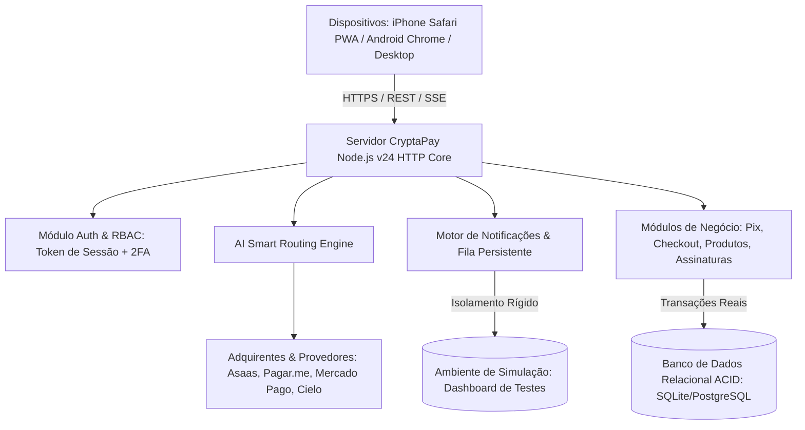

# CRYPTAPAY — Arquitetura da Plataforma & Plano Diretor de Engenharia

> Plataforma de Pagamentos e Gateway de Alta Performance com Inteligência de Roteamento, Design Glassmorphism Deep Black & Electric Purple, Simulador de Notificações Isolado e Suporte PWA Mobile.

---

## 1. Visão Geral da Arquitetura

O **CryptaPay** foi concebido sob uma arquitetura modular, limpa e de altíssima velocidade, sem dependências pesadas ou lentidões. Todo o ecossistema roda com tecnologia de ponta:

### Princípios Invioláveis do Projeto
1. **Segregação de Ambientes**: O motor de testes e simulação de notificações nunca se mistura com dados financeiros reais, saldos de saque, relatórios fiscais ou clientes reais.
2. **Zero Telas Decorativas**: Cada botão, formulário e atalho possui funcionalidade real, resposta da API e persistência. Quando uma chave de adquirente externa não estiver preenchida, o sistema exibe o status de *Configuração Pendente* com instruções claras.
3. **Identidade Visual Premium**:
   - Fundo principal: Deep Black (`#08080C` e `#0D0D14`)
   - Destaque: Roxo Elétrico (`#8B5CF6`, `#7C3AED`, `#A855F7`)
   - Efeito Glassmorphism com bordas sutis iluminadas (`rgba(139, 92, 246, 0.25)`)
   - Alternância instantânea de **Tema Escuro** e **Tema Claro**
   - Animações fluidas, cartões 3D com efeito de profundidade e gráficos interativos.
4. **Instalação PWA Nativa**: Ícone na tela de início, tela de abertura (splash) personalizada e compatibilidade total com iOS Safari e Android.

---

## 2. Mapa dos Módulos do Sistema (Menu Lateral Completo)

| # | Módulo | Descrição & Funcionalidades Principais |
|---|---|---|
| **01** | **Dashboard** | 10 indicadores financeiros reais, gráficos de faturamento por período, filtros (Hoje, Ontem, 7D, 30D, Mês, Customizado) e atalhos rápidos. |
| **02** | **Pagamento Rápido** | Gerador instantâneo de cobrança Pix com QR Code dinâmico, Copia e Cola, expiração e cópia em 1 clique. |
| **03** | **Vendas** | Listagem detalhada de pedidos, busca por ID, filtros por status (Aprovada, Pendente, Recusada, Reembolsada) e detalhes da transação. |
| **04** | **Transações** | Visão analítica transacional, taxas aplicadas, valor líquido retido e conciliação. |
| **05** | **Adquirentes & Smart Routing** | Conexão multi-provedor (Asaas, Pagar.me, MP, Cielo), fallback inteligente por taxas, disponibilidade e idempotência. |
| **06** | **Financeiro & Saques Pix** | Saldo disponível, pendente e em retenção; solicitação de saque Pix com cálculo de taxa e extrato completo. |
| **07** | **Produtos** | Cadastro e gestão de produtos (digitais, físicos, cursos, infoprodutos e serviços), preços e controle de status. |
| **08** | **Checkout Customizável** | Criador de checkout de alta conversão: edição de logotipo, cores, banners, upsell, ofertas e prévia em tempo real. |
| **09** | **Meus Links** | Geração e gerenciamento de links diretos de pagamento com contador de cliques e conversões. |
| **10** | **Clientes** | Base de clientes com histórico de compras, LTV (Total gasto) e última compra. |
| **11** | **Assinaturas** | Planos recorrentes, gestão de assinantes, controle de renovação e cancelamento. |
| **12** | **Cofrinho** | Metas financeiras de economia com barra de progresso e datas limite. |
| **13** | **Cursos** | Área de membros com módulos, aulas, vídeos e controle de acesso para compradores. |
| **14** | **Integrações & API** | Geração de credenciais de API (`crypta_live_...` e `crypta_test_...`), documentação interativa e rota de consulta. |
| **15** | **Webhooks** | Cadastro de URLs de webhook, segredo HMAC-SHA256 para validação de assinatura, logs de envio e repetição. |
| **16** | **Análises & Rastreamento** | Métricas de conversão de checkout, origem de tráfego, pixel e campanhas. |
| **17** | **Central de Notificações** | **Recurso Prioritário**: Seletor de volume (1 a 100), sequência alternada (Pendente/Aprovada), valores realistas, velocidade ajustável, agendador e fila persistente. |
| **18** | **Dashboard de Testes** | Painel exclusivo para simulações: Faturamento Simulado isolado, ROI Simulado com custo de anúncio e histórico de rodadas. |
| **19** | **Premiações** | Placas 3D iluminadas (10k, 30k, 50k, 100k, 500k, 1M, 10M), pulseiras de conquista e premiação especial iPhone Pro Max bordô (baseado em faturamento real elegível). |
| **20** | **Corrida de Faturamento** | Ranking gamificado entre vendedores autorizados com acompanhamento de posições. |
| **21** | **Black Voice** | Acompanhamento de metas de elite (ex: R$ 500 mil) com animações de avanço. |
| **22** | **Central Telegram** | Conexão com Bot do Telegram para alertas de vendas aprovadas. |
| **23** | **Black Suporte** | Sistema de chamados interno com histórico, prioridades e envio de mensagens. |
| **24** | **Privacidade & LGPD** | Exportação de dados do titular, consentimentos e termos de privacidade. |
| **25** | **Configurações** | Perfil do vendedor, dados bancários, 2FA, gerenciamento de sessões ativas e tema. |
| **26** | **Painel Administrativo Master** | Acesso restrito com credenciais fortes para os 2 administradores, controle de usuários, aprovação de saques e monitoramento global. |
| **27** | **Política de Uso** | Termos rígidos antifraude, proibindo golpes, falsas cobranças e exigindo compliance. |

---

## 3. Guia de Instalação PWA (Celular & Tablet)

### Para iPhone / iPad (Navegador Safari)
1. Abra o CryptaPay no **Safari**.
2. Toque no botão de **Compartilhar** (ícone do quadrado com a seta para cima, na barra inferior).
3. Role para baixo e selecione **"Adicionar à Tela de Início"** (ícone com o sinal de `+`).
4. Confirme o nome **CryptaPay** e toque em **"Adicionar"** no canto superior direito.
5. O ícone da CryptaPay aparecerá na tela do celular como um aplicativo nativo em tela cheia, sem a barra do navegador!

### Para celulares Android (Navegador Chrome)
1. Abra o CryptaPay no **Google Chrome**.
2. Toque nos **três pontinhos** no canto superior direito (menu do navegador).
3. Selecione **"Instalar aplicativo"** ou **"Adicionar à tela inicial"**.
4. Toque em **"Instalar"**.
5. O aplicativo será instalado diretamente na sua gaveta de apps com suporte a notificações push.

---

## 4. Cronograma de Construção por Fases

- [x] **Fase 0**: Análise de Requisitos, Especificação Técnica e Estrutura de Diretórios
- [ ] **Fase 1**: Estrutura Visual, Identidade CryptaPay, Landing Page Cinematográfica, Login/Cadastro, Sidebar Completa (27 itens), Dashboard e Alternância de Tema Claro/Escuro
- [ ] **Fase 2**: Backend HTTP de Alta Performance, Banco de Dados Relacional SQLite ACID, Autenticação com Senhas Seguras (Scrypt), Sessões e RBAC
- [ ] **Fase 3**: Financeiro, Pagamento Rápido com Pix Dinâmico, Vendas, Transações, Saques Pix e Motor AI Smart Routing
- [ ] **Fase 4**: Gestão de Produtos, Checkout Personalizável, Links de Pagamento, Assinaturas, Clientes, API Keys e Webhooks HMAC
- [ ] **Fase 5**: Central de Notificações Avançada, Fila de Simulação no Backend (1 a 100), Alternância Pendente/Aprovada, Dashboard Exclusiva de Testes, ROI Simulado e PWA
- [ ] **Fase 6**: Gamificação, Placas 3D de Premiação, Pulseiras, Corrida de Faturamento, Black Voice, Cofrinho, Cursos e Suporte
- [ ] **Fase 7**: Painel Administrativo Master, Auditoria de Segurança, Testes Automatizados e Guia Final de Homologação
